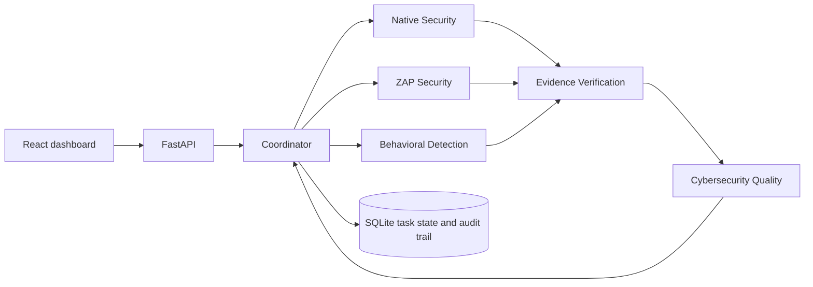

# CyberQ Multi-Agent

CyberQ Multi-Agent is a university cybersecurity assessment project for an
authorized Moodle environment. It coordinates five specialized agents to combine
security posture, OWASP ZAP evidence and behavioral detection, verify their
provenance, and produce an auditable Cybersecurity Quality Index (CQI) assessment.

The application extends an existing research platform with a FastAPI backend,
React interface and persistent assessment traces. Agents use deterministic
workflows and existing ML models; **no hosted LLM calls are claimed**.

## Objectives and features

- Coordinate all five specialists in one task with a shared assessment ID.
- Preserve independent Native, ZAP and Behavioral operations.
- Process 83 behavioral features using frozen OCSVM and XGBoost models, with
  TreeSHAP explanations and incident aggregation.
- Verify artifact hashes, provenance, identities, consistency and missing evidence.
- Calculate CQI dimensions D1–D6 using the existing scientific implementation.
- Record structured JSON messages, real tool attempts, timings and workload shares.
- Enforce task budgets, bounded retries, exclusive execution and laboratory ownership.

## Architecture



| Role | Responsibility | Registered tools |
| --- | --- | ---: |
| Coordinator | Dispatch, dependencies, limits and final delivery; no domain tools | 0 |
| Native Security Agent | Resolve Native posture evidence and map controls | 2 |
| ZAP Security Agent | Resolve scanner evidence, profile and assessment scope | 2 |
| Behavioral Detection Agent | Resolve windows, inference, explanations and incidents | 3 |
| Evidence Verification Agent | Independently verify artifacts, claims and journal records | 3 |
| Cybersecurity Quality Agent | Invoke CQI and check calculation consistency | 2 |

Tools reuse the existing platform. Live Native/ZAP share the existing posture
job; Behavioral reads a bounded snapshot from an already active owned monitor.
The assessment never starts monitoring automatically. See the
[architecture and tool registry](docs/assignment4/ARCHITECTURE.md),
[typed message schemas](docs/assignment4/schemas.json) and
[executed message examples](docs/assignment4/real-messages.json).

## Technologies and requirements

- Python 3.10; FastAPI, Uvicorn and Pydantic.
- React 19 and Vite 8; frontend validation used Node.js 24.
- NumPy, pandas, scikit-learn, XGBoost and joblib; native TreeSHAP explanations.
- SQLite for task state and observation journals; pytest and Node test runner.
- Authorized Moodle/Apache and OWASP ZAP for optional live assessment.

Dependency specifications are in [requirements.txt](requirements.txt),
[requirements/](requirements/), [backend requirements](demo/backend/requirements.txt)
and [package.json](demo/frontend/package.json), with an npm lockfile.

**This public repository is a source release, not a self-contained laboratory
image.** Models, raw logs, replay datasets, saved scanner results, private
configuration and generated reports are excluded. The demonstration additionally
requires the matching research artifact bundle and manifests, including the
sources declared in [artifact_sources.json](demo/artifact_sources.json).
Request access from the project author for supervised reproduction; do not
substitute invented evidence or download unrelated models.

## Setup and execution

The current isolation layer is deliberately tied to the provisioned Ubuntu
coursework workspace and disk. A fresh GitHub clone at an arbitrary path is
**not supported as a runnable installation**. Read the
[isolation requirements](docs/COURSEWORK_ISOLATION.md) before execution.
Do not use the dissertation checkout or activate the copied legacy virtualenv.

For the provisioned environment, from its repository root:

```bash
# Verify isolation and preservation before application execution.
/usr/bin/python3 -I -S scripts/coursework_check.py --preservation --source-proof

# Retain or prepare the independent environment from its approved local payload.
/usr/bin/python3 -I -S scripts/coursework_prepare.py

# Build coursework assets, then start the foreground application.
.venv-coursework/lib/python3.10/site-packages/playwright/driver/node \
  demo/frontend/scripts/build_coursework.mjs
.venv-coursework/bin/python -I -B scripts/coursework_serve.py
```

Open **http://127.0.0.1:8001**. Stop the foreground server with **Ctrl-C**.
Preparation needs the locally provisioned dependency payload; it is not a
replacement for a complete public installation package. Generated state and
versioned builds stay under `runtime/coursework/`.

The unchanged isolation checks require **no configured Git remotes**. A publication
checkout with `origin` restored will fail the check and guarded Python startup.
Use the provisioned execution copy under its documented controls, separately from
publication. Never weaken the check or bypass it to run a GitHub checkout.

## Offline demonstration

1. Start the provisioned application and select **OFFLINE_EVIDENCE** in Overview.
2. Select an available preserved scenario and press **Run Full Assessment**.
3. Follow the five specialist states under one task ID.
4. Inspect findings and source limitations in Overview, branch details in
   Security Posture and Behavioral Monitoring, and JSON messages, tools and
   workload in Multi-Agent.
5. Export the task trace and discuss VERIFIED/PARTIAL outcomes separately from
   workflow completion.

CLI alternative, with the same required artifacts and safety checks:

```bash
timeout 110s .venv-coursework/bin/python -I -B scripts/run_multiagent.py \
  --scenario sqli_run --export
```

Offline Native/ZAP results come from authentic saved evidence. Behavioral replay
can perform new inference from historical requests; this is neither a new scan
nor live monitoring. See the [demonstration guide](docs/assignment4/DEMONSTRATION.md).

## Authorized live assessment

Live access is denied by default. It requires an explicitly authorized target and
profile, authenticated scanner configuration, a verified isolated ZAP instance,
exclusive laboratory ownership and a valid finite lease. A UI selection or
request flag does not grant authorization.

After the operator completes those prerequisites, standalone Native, ZAP and
monitoring controls remain available. A LIVE_LAB Full Assessment can request fresh
Native/ZAP collection and reuse an already running coursework monitoring session.
Absent behavioral windows are reported explicitly; saved replay is not substituted.
Independent branch operations do not publish the official overall CQI.

Public users cannot reproduce the live experiment without the approved laboratory,
models, evidence and operator handoff. No live operation is authorized by this
README. Consult the [operator guide](docs/assignment4/LIVE_LAB_OPERATOR_GUIDE.md);
its dated workstation-specific observations are historical, not current readiness.

## Validation and results

| Evidence level | Verified scope and limitation |
| --- | --- |
| Offline orchestration | All five specialists executed in one persisted task with actual registered tools and dependency-bound JSON messages. |
| Workload | A documented normal run made 12 specialist tool attempts: 2/2/3/3/2. Maximum share was 25%; Coordinator domain calls were zero. LLM shares are N/A because there were no LLM calls. |
| Scenario validation | Seven historical scenarios and controlled failure cases were exercised. A passed rejection test is not a successful security assessment. |
| Observed live execution | Completed coursework task `ma-d7d6bb91416842df82705bccd1a0e50e` is recorded locally. This is an observed laboratory execution, not independent validation of detector performance. |
| Detection performance | Requires the separate controlled benchmark protocol and matching datasets; orchestration tests do not establish accuracy or generalization. |
| CQI | Calculation and evidence mappings are under audit. Stored scores are not presented here as validated research findings. CQI is an ordinal index, not attack probability. |

See the dated [execution proof](docs/assignment4/FINAL_EXECUTION_PROOF.md) and
[scenario/workload record](docs/assignment4/RESULTS.md). Their test totals describe
specific runs, not a promise that an artifact-free clone passes those suites.
Browser click-through was not verified in the documented offline acceptance run.

Focused reproduction commands in the provisioned environment:

```bash
# Historical scenarios and explicitly local monitoring adapters; no shared lab.
.venv-coursework/bin/python -I -B scripts/validate_multiagent.py --platform

# Existing offline backend checks, feature extraction and frozen-model inference.
.venv-coursework/bin/python -I -B scripts/coursework_offline_check.py

# Export real local UI fixtures, then validate frontend rendering.
.venv-coursework/bin/python -I -B scripts/coursework_export_ui.py
.venv-coursework/bin/python -I -B scripts/export_multiagent_fixture.py
/usr/bin/python3 -I -S scripts/check_coursework_frontend.py
```

These commands require local artifacts and create coursework-only test state.
They do not authorize scans or shared-log monitoring.

## Repository and scientific documentation

```text
coursework/       Isolation, ownership controls and multi-agent orchestration
demo/backend/     FastAPI application and existing platform services
demo/frontend/    React interface, assets source and frontend tests
src/              Native/ZAP integration, behavioral ML, evidence, CQI and reports
tests/            Unit, integration, scenario and regression tests
scripts/          Guarded launch, validation, demonstration and reporting tools
requirements/     Additional Python dependency specifications
docs/             Architecture, protocols, scientific methods and dated validation
lab/              Controlled validator benchmark application
```

Start with the [documentation index](docs/README.md). Scientific references include
the [CQI mathematical model](docs/research/CQI_MATHEMATICAL_MODEL.md) and
[behavioral benchmark protocol](docs/research/BEHAVIORAL_MODEL_BENCHMARK.md).
Private task databases, raw research evidence and generated examination PDFs are
not included in the public release.
