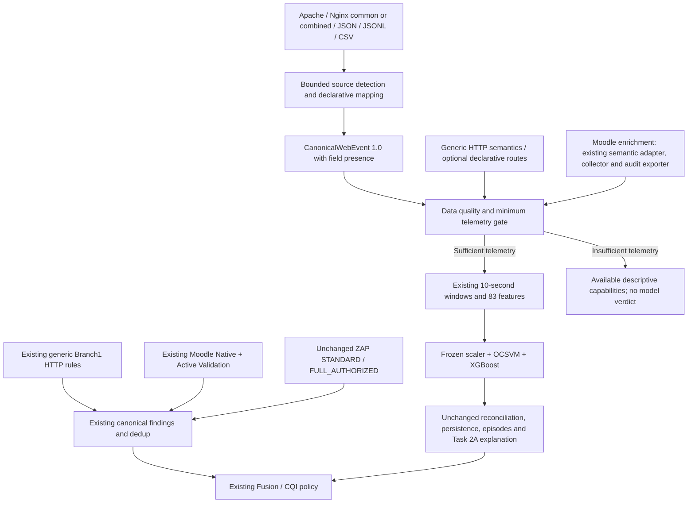

# Platform-independent normalization and Moodle compatibility

Task 2C adds an ingestion boundary around the accepted analytical implementation.
It does not replace the accepted model, score policy or Moodle collectors. Moodle
is the experimentally validated reference, not a required parser for every source.



## Compatibility boundary and production routing

The frozen package verifies source hashes for parsing, features and inference.
Those files remain untouched. The existing Moodle live engine and journal remain
the production compatibility baseline. The new offline bridge produces the same
numerical input contract using the original extractors; it is an additional
ingestion route, not a replacement live reader. New ingestion diagnostics do not
attach an arbitrary new platform's observations to the current Moodle runtime/CQI.
That existing target-identity guard remains enforced.

A pre-change reference recorded all 101 accepted observation hashes, feature
hashes and 16 incident summaries. The shadow acceptance reprocesses the same raw
accepted source material, proves equality and checks the reference again. For
blind browser records, the original source log has rotated. A compressed archive
is used only after its exact original byte range matches the immutable slice
SHA256. Session marker/actor attribution and all record ranges/hashes are replayed;
foreign records remain excluded. The original manifests are not changed and no
new capture/inode-verification receipt is claimed.

Non-lab, explicitly authorized posture targets now execute the existing
`GenericRules.transport_and_headers` and `cors_methods_exposure` implementations
instead of skipping Native entirely. The lab target still uses precisely the
previous Native orchestration branch. No scanner policy, method payload, validator,
timeout or CQI coefficient is changed. ZAP remains independent of platform identity.

## Canonical schema and presence

`canonical-web-security-event-1.0` contains the actual extractor inputs:
timestamp, client identifier, method, path, query, status, response bytes,
user-agent, referrer, authenticated user identifier, session identifier and role.
It also permits explicit authentication state, content type, host, scheme and
response time for capability/context reporting; these are not new fitted features.
An infrastructure-dummy flag preserves existing Apache exclusion semantics.

`observed_fields` records provided, interpretable values. `missing_fields` includes
absent/null values. An empty query is observed; an absent query is not. A path-only
column does not establish that the query was empty. Full request targets such as
`request_uri` establish both path and query, including an empty query. Explicit
query fields or a reviewed constant mapping can also establish an empty query.
A literal query `-` is preserved; optional log dash sentinels mean unavailable.

Canonical parsing can succeed with incomplete analytical inputs. The separate
minimum-contract gate decides whether the complete model can execute. Missing
data is never a security PASS or an inferred BENIGN observation.

Provenance includes source/batch and record hashes, source record number, adapter
ID/version, mapping hash, canonical version, platform identity and field coverage.
Client/user/session identifiers are deterministically hashed. The Moodle wrapper
does not hash already pseudonymized legacy identifiers a second time.

## Supported source formats and detection

- Apache combined syntax uses the exact existing parser. Common syntax adds only
  absent referrer/user-agent placeholders, preserving optional-missing semantics.
- Representative Nginx common/combined syntax uses the same HTTP interpretation.
  Custom Nginx `log_format` extensions require structured export or another parser.
- JSON accepts one record object or an array of record objects.
- JSONL accepts one JSON object per line.
- CSV accepts a unique header and consistently sized rows.

Autodetection is deterministic: complete JSON, object-per-line JSONL, common/combined
log syntax, or a CSV header with multiple known canonical aliases. It does not infer
Apache versus Nginx vendor from identical syntax. Unrecognized/ambiguous formats
return `MAPPING_REQUIRED`; explicit format selection is available. Proprietary
binary data, arbitrary log templates and guessed timestamp units are unsupported.

Bounds: 8 MB source bytes, 20,000 records and 128 KiB per record. UTF-8 is required.
Timestamps use explicit timezones or numeric epoch seconds, normalized to UTC.
Methods become uppercase; host/scheme become lowercase; statuses/bytes are validated
nonnegative integers (status 100–599). Query lexical structure is not decoded or
removed at ingestion: decoding remains exactly the original feature extractor's job.

## Declarative mappings

Aliases cover timestamp/time/event_time/datetime/@timestamp, common client and
method names, path/URI/URL/request targets, status and byte variants, and explicit
optional context. Multiple matching aliases are ambiguous even if values agree;
an explicit mapping resolves them. Mapping metadata shows selected source fields,
not their values. Nested JSON paths use dot lookup, with exact keys taking priority.

Example mapping JSON:

```json
{
  "timestamp": "event.when",
  "client_id": "network.remote_addr",
  "method": "http_verb",
  "path": "request_uri",
  "query": "query_string",
  "status": "response_code",
  "response_bytes": "response_size",
  "source_platform": {"constant": "generic_web"}
}
```

`{"constant":""}` is a deliberate observed-empty query declaration, not the
default for missing telemetry. Mapping constants must be truthful source semantics.
Platform metadata in an event does not silently select an enrichment adapter;
`--platform` explicitly selects the adapter. No Python code or YAML dependency is
required. Expressions, executable transforms and invalid canonical types are rejected.

## Feature dependencies and the minimum contract

The machine-readable 83-row dependency matrix is generated by
`platform_normalization.dependencies.dependency_matrix`, recording each feature's
actual source implementation, raw inputs, optional fields, missing policy and
grouping inputs. It covers **69 required-input features and 14 optional-flagged
features**, in exactly the accepted feature order.

| Feature family | Actual input dependency |
|---|---|
| Counts/rate, span, inter-request gaps | UTC timestamp and client/window grouping |
| Path diversity, repetition, breadth | Path |
| Method distribution | Method |
| HTTP status distribution | Status |
| Query length, parameter/encoding/SQL/XSS lexical counters | Observed query |
| Traversal and combined suspicious ratio | Path and observed query |
| Semantic navigation, authentication paths, assets/resources | Path/method through the existing semantic adapter |
| Byte totals/distribution/coverage | Optional response bytes with accepted coverage flag |
| Identity/session/role counts and coverage | Optional explicit context with accepted coverage flags |

Minimum required fields for full accepted numerical inference are **timestamp,
client_id, method, path, observed query and status** on every usable event. Optional
user-agent absence uses the frozen missing-UA grouping convention. Absent response
bytes/user/session/role retain the already accepted neutral values plus observed
ratios; they are never represented as known zero-size responses or known roles.
Referrer, authentication state and response timing do not add hidden model inputs.

States are `BEHAVIORAL_FULLY_COMPATIBLE`,
`BEHAVIORAL_COMPATIBLE_WITH_OPTIONAL_CONTEXT_MISSING`, and
`BEHAVIORAL_INSUFFICIENT_TELEMETRY`. Required omissions, rejected-record batches
and dummy-only batches block inference. Descriptive capabilities may still be
available. This is numerical/semantic compatibility, not evidence of equivalent
statistical accuracy on a new platform or deployment.

## Adapters and Branch1 applicability

`GenericWebPlatformAdapter` wraps the existing `GenericHTTPBehaviorAdapter`.
It reuses asset recognition and optional exact path-to-canonical-category mappings.
An unreviewed non-asset route is conservatively UNKNOWN, rather than inferred
navigation. The existing frozen `unknown_semantic_ratio` records that uncertainty;
the capability report also counts unknown semantic mappings. Explicit declarative
routes add knowledge without another Python adapter. No feature definition or
Moodle category mapping changes. It does not infer Moodle routes, identities, roles, plugin
versions, authentication outcomes or configuration. `MoodleAdapter` wraps the
unchanged `MoodleBehaviorAdapter`, references existing Native/internal/intelligence/
role implementations and exposes the existing sanitized Moodle audit exporter.
No empty adapters are registered for untested LMS products.

The Branch1 control inventory is classified as `GENERIC_HTTP`,
`GENERIC_WEB_SERVER`, `INTERNAL_SERVER`, `PLATFORM_MOODLE` or
`ROLE_CONTEXT_REQUIRED`. The existing cookie checker explicitly expects
MoodleSession, so generic cookie evaluation is honestly unavailable. Generic
posture does not run Moodle endpoint probes, collectors or advisory assertions.
Missing internal collectors and verified roles remain unavailable, not PASS.

Generic requests use the existing bounded transport and scope revalidation.
Only the base URL, existing nonexistent-page probe and existing root exposures
that fall within the authorized deployment scope are reviewed. Header/method
variants remain distinct. The request ceiling is reviewed variants × four
(initial request plus three redirects), with a 60-second stage deadline and the
existing response/time limits. Off-origin, unreviewed redirects and off-scope
root exposures are denied. Failures preserve other posture stages. Repository
Active Validation remains subject to its existing Moodle-lab safety gate;
generic validator execution is not claimed merely because a family exists.

## Capabilities and measured coverage

The denominator was fixed before fixture evaluation: **20 user-facing
capabilities**, enumerated in `capabilities.CAPABILITIES`. Each reports
AVAILABLE/PARTIAL/NOT_AVAILABLE/NOT_APPLICABLE and a reason. No state is a finding
verdict. Only AVAILABLE counts; PARTIAL earns zero credit, and NOT_APPLICABLE
does not reduce the denominator. Existing CQI never consumes this percentage.

| Fixture/source | Available | Coverage | Behavioral contract |
|---|---:|---:|---|
| Accepted Moodle source | 13/20 | 65% | Compatible with optional context missing |
| Generic rich HTTP telemetry | 13/20 | 65% | Compatible with optional context missing |
| Generic partial telemetry | 9/20 | 45% | Insufficient: query absent |

These are engineering fixture measurements **assuming an explicitly authorized
HTTP target and ready ZAP runtime**, not newly executed posture or ZAP results.
No fresh verified internal collector, patch baseline or role session is assumed,
even for the Moodle source. Inspect-only API defaults assume none of those
operational prerequisites, so a telemetry-only inspection reports lower coverage.
This distinction prevents logs alone from claiming scanner readiness. The rich
fixture exceeds the desired 60% goal without counting unsupported cookie checks,
partial validators or absent role/session/authentication context as available.

## Quality, privacy and reproducibility

Batch diagnostics record input/parsed/rejected/emitted counts, timestamp/status/
bytes/URL errors, missing required/optional coverage and mapping warnings. Rejected
rows retain ordinal/hash/reason only. Errors are bounded to 20 details; counts
cover all records. Entirely unrecognized schemas fail, and alias ambiguity demands
mapping. Individual malformed rows yield PARTIAL, but accepted-model execution
remains conservatively blocked for that batch. It does not silently ignore errors.

Security-relevant queries are transient analysis input. Diagnostic API/CLI exports
do not include canonical raw events, query values, user-agent/referrer strings,
cookies, headers, bodies or original identity/session tokens. Canonical safe
evidence exports hashes and structural metadata. Numeric predictions and derived
feature evidence remain subject to existing Task 2A privacy semantics. There is
no LLM, external service, model fitting or background ingestion service.

The same bytes, mapping and adapter version give identical analytical events and
hashes. Source format/provenance differences are compared separately from analytical
fields. No wall clock enters the vector or factor ranking. Format-invariance tests
compare three equivalent fixture events/two windows in five formats. The fixture is
not a newly collected experimental dataset or a validated additional LMS.

## Acceptance and performance

`outputs/normalization/task2c_03/` contains the dependency matrix, Branch1 applicability
inventory, capability/quality diagnostics, format equality, exact per-window hashes,
accepted evidence references and performance. `task2c_01` preserves the initial
successful shadow pass. `task2c_02` retains the intermediate diagnostic pass.
The final pass includes conservative UNKNOWN mapping for generic routes and
hashed route-configuration metadata. These are ingestion semantics decisions,
not model tuning or changes selected against holdout performance.

Moodle compatibility passed across **101 windows (33 benign, 68 attack), 1,197
accepted events**. Event fields, feature order/vectors, scaler outputs, saved-model
predictions, reconciliation, episode grouping and explanation values are exactly
equal between legacy and normalized paths. Saved OCSVM/XGBoost outputs additionally
match to absolute tolerance 1e-10, with exact verdicts/classes. All 101 pre-change
application observation hashes and 16 incident summaries remain unchanged.

One final measured ingestion pass through the 14 existing accepted attack logs
processed 274 records in approximately 19.5 ms: about **14,050 records/s**
(0.0712 ms/record). It includes file reads, excludes cold imports/model loading,
and is a lightweight local measurement, not a deployment capacity guarantee.
The first pass was slower; no performance tuning or model changes followed.

## Operator/onboarding workflow

1. Supply an explicitly authorized application URL for existing STANDARD posture.
2. Supply standard web telemetry; do not send credentials or raw bodies.
3. Auto-detect or explicitly select format and inspect mapping/quality.
4. Supply a JSON mapping if ambiguous; preserve the query observation distinction.
5. Review the 20-capability matrix and minimum model contract.
6. Execute available generic capabilities. Keep source identity separate from
   unrelated Moodle live telemetry/CQI. Do not assume statistical domain transfer.
7. Optionally add a reviewed enrichment adapter and route map without changing the
   extractor/model or canonical evidence core.
8. Validate source parsing, canonical categories, features, predictions, incidents
   and explanations on representative platform evidence before stronger claims.

```sh
PYTHONPATH=src:. .venv/bin/python -B scripts/normalize_web_telemetry.py \
  --input tests/fixtures/normalization/events.jsonl --format jsonl \
  --platform generic_web --out /tmp/web-telemetry-diagnostics.json

# Optional saved inference, only after the capability gate passes:
PYTHONPATH=src:. .venv/bin/python -B scripts/normalize_web_telemetry.py \
  --input tests/fixtures/normalization/events.csv --format csv --predict \
  --out /tmp/web-telemetry-predictions.json
```

Route-configuration values are not exported; adapter metadata records their hash
and count, plus source identity and implementation hashes.

Output files are exclusive-create. The System/Evidence page adds only a compact
memory-only inspection form and technical details. API endpoints are
`GET /api/ingestion/schema` and locally guarded `POST /api/ingestion/inspect`.
The latter accepts `{text, format, platform, mapping}`, returns typed diagnostics,
and never scans, fits, persists source data or changes the current runtime source.

Final product acceptance uses `scripts/accept_normalization_ui.py`: a temporary
loopback instance of the same FastAPI app and built frontend, with the existing
installed browser. Rich and insufficient samples pass through the real endpoint
and render in System/Evidence. Only this temporary child is stopped afterward.
The operator's port-8000 backend had an active live monitor during final checks;
it was deliberately left running. Its next ordinary restart is needed to load
the added API router. The temporary acceptance is not represented as a reload
of that running backend, nor as a new live-platform experiment.

## Supported and unsupported research claims

The analytical core is platform-extensible and Moodle-validated. Generic web-
security and behavioral capabilities can operate on normalized standard web
telemetry without a Moodle-specific code adapter. Platform-specific capabilities
require enrichment, prerequisites and validation.

Not established: equal accuracy on other LMS, new-platform model calibration,
population-level generalization, arbitrary proprietary parser support, generic
authenticated coverage or executable generic active validators. Apache logs still
omit POST bodies; lexical ATTEMPT labels never establish successful exploitation.
The benchmark decision KEEP_OCSVM, frozen accepted package and CQI policy remain
unchanged. A future generalized live reader must be validated and released as a
new runtime wrapper rather than silently modifying hash-bound inference code.
