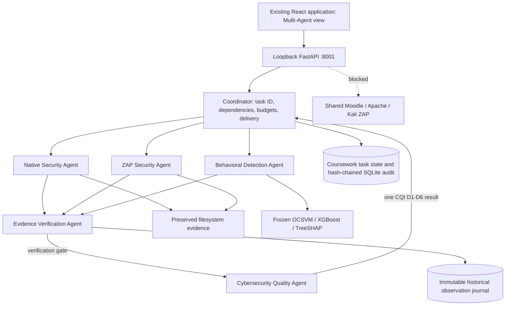
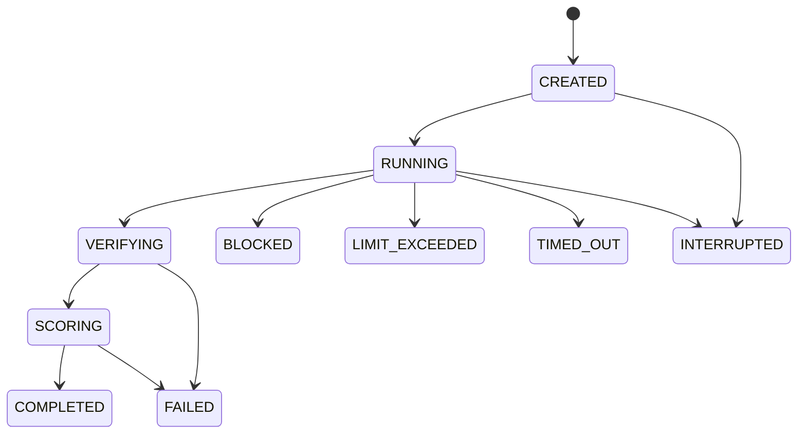

# Assignment 4 architecture

This is an additive coursework layer. Existing research models, feature schema,
taxonomies, adapters, evidence semantics and CQI policies are unchanged. Source
artifacts are never rewritten. Specialists run sequentially: concurrency is
optional in the specification, and deterministic ordering simplifies examination
reproduction without shared-state races. A cross-process lock admits one task.

## Specialist specifications and registry

| Agent | Responsibility | Registered tools | Dependencies |
| --- | --- | --- | --- |
| Coordinator | Route typed messages, own task state, enforce budgets, deliver Quality result | 0 | None |
| Native Security | Read frozen Native baseline; preserve finding semantics; map established controls | `native.read_baseline`, `native.map_controls` (2) | Coordinator dispatch |
| ZAP Security | Verify saved assessment/profile/session scope; enforce shared-lab lock | `zap.read_assessment`, `zap.check_profile` (2) | Coordinator dispatch |
| Behavioral Detection | Resolve genuine 83-feature windows; actual saved OCSVM/XGBoost inference; TreeSHAP and incidents | `behavior.extract_features`, `behavior.infer`, `behavior.explain_incidents` (3) | Coordinator dispatch |
| Evidence Verification | Independently check artifact hashes, provenance, record identity/consistency, duplicates, temporal limitations and SQLite integrity | `verify.artifacts`, `verify.consistency`, `verify.journal` (3) | All three evidence specialists |
| Cybersecurity Quality | Reject invalid/conflicted/missing inputs; run unchanged versioned CQI; compare to existing accepted-replay implementation | `quality.evaluate`, `quality.check_result` (2) | Verification |

Registry owner checks reject foreign/unregistered tool use. All five specialist
results are strict `AgentResult` values. Each Coordinator dispatch names the
upstream RESULT message IDs; Verification depends on Native/ZAP/Behavioral and
Quality depends on Verification. Tool attempts reference the dispatch ID. The
Coordinator never invokes a security tool, calculates a score, or manufactures
findings. Registered tools implement domain work under specialist ownership.

## Integration classification

| Integration | Actual access | Classification |
| --- | --- | --- |
| Preserved artifact store | Read-only JSON, Apache capture files and frozen feature/model manifests | External filesystem data source, allowed by the stated coursework specification |
| Retained observation journal | Real SQLite queries through the existing immutable journal reader; record hashes and cursor checked | External database data source; independent historical corroboration, not paired scored observations |
| Frozen behavioral model | Existing package loader, numerical inference and native exact TreeSHAP | Local code execution / AI tool; not an external hosted API |
| Native canonical mapper, incident helper, CQI evaluator | Existing project functions | Internal helpers wrapped as role-specific registered tools; not additional external integrations |
| Moodle/Apache live/Kali ZAP | No calls | Preserved live capabilities, locked and unverified |
| Hosted LLM | No calls, keys or provider | LLM count zero; LLM percentages N/A |

Reading many files inside one registered tool is still one registered invocation.
The audit records that boundary and names its implementation; it does not inflate
percentages by counting every internal helper, DB query or log write as a tool.
Failure/retry attempts count exactly when the registered callable is entered.

## Shared state and transitions

`runtime/coursework/multiagent/tasks.sqlite3` contains `tasks`, `events` and
`rejections`. SQLite WAL/SHM are in that same coursework directory. Tasks have a
stable ID, strict request, role states, messages, outputs, evidence references,
verification, steps, final result or structured failure. State and each event
commit together. Read APIs omit private raw tool payloads. Public traces contain
summaries, explicit sources and computed hashes; no raw request logs or keys.

Any active stage may fail, time out or exceed its step budget. Terminal states
cannot change into other states. A crash leaves audit/state intact; the next
exclusive runner marks abandoned work INTERRUPTED and never resumes it
automatically. An idempotency key returns the same task, without new tool writes;
reusing it with different parameters is rejected. Concurrent runs return a
structured busy error. There is no unbounded task queue or agent loop.

Defaults: 18 registered attempts, 90 seconds per task, 30 seconds per tool, one
retry. Hard accepted maxima: 40 attempts, 120 seconds, 60 seconds and two retries.
Only explicitly retryable failures retry; schema/integrity errors do not. Logical
deadlines are checked before and after tools and inside bounded file/vector loops.
Late native inference is discarded, but a native call is not forcibly preempted.

## Schemas and APIs

`schemas.json` defines TaskRequest, TaskState, Message, AgentResult, ToolArguments,
ToolResult, EvidenceRef, VerificationOutcome and Failure. Unknown fields are
rejected; IDs/hashes and timezone-bearing message/evidence timestamps are checked.
Typed envelopes have structured per-tool data; substantive domain validation is
performed independently by Verification and Quality. See real-messages.json for
actual executed messages, not invented examples.

- `GET /api/multiagent/spec`: roles, registry, schemas, scenarios and limits.
- `POST /api/multiagent/tasks`: X-Product-Control required; returns task ID (202).
- `GET /api/multiagent/tasks`: recent saved tasks.
- `GET /api/multiagent/tasks/{task_id}`: state, progress and measured distributions.
- `GET /api/multiagent/tasks/{task_id}/events`: verified hash chain, actual attempts.
- `GET /api/multiagent/tasks/{task_id}/export`: public state and reproducible trace.

Existing application APIs, reports and historical navigation remain available.
Frontend build output has its own versioned runtime directory and safe pointer;
the saved original builds and research receipts are untouched.
