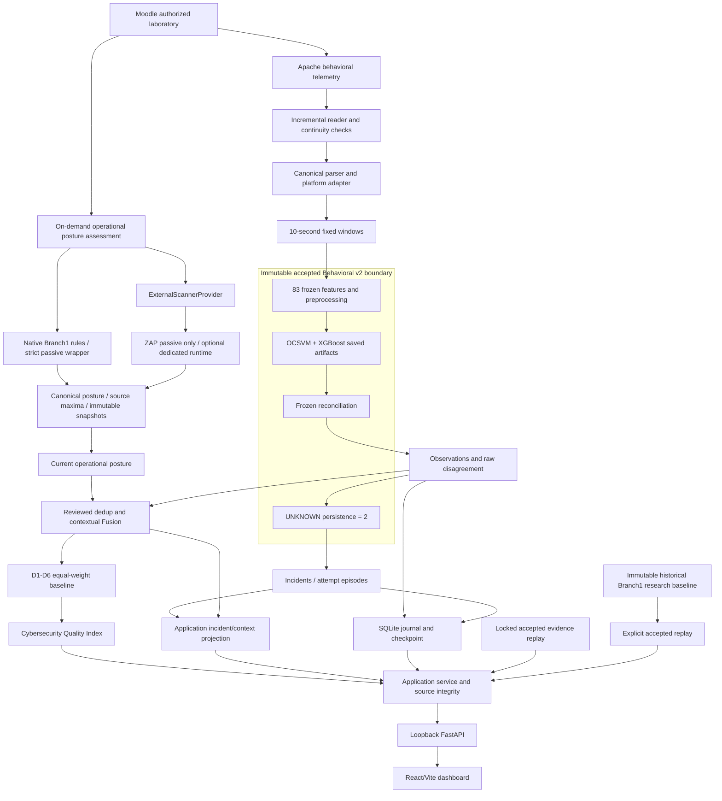

# Final research prototype architecture

**Research layer:** immutable accepted posture, Model v1 baseline, frozen
development/holdout evidence, accepted v2 package, Fusion/CQI policy, tables and
paired reports. No fitting or policy selection occurs during the demo.

**Operational posture layer:** `src/posture/` wraps the existing native rule
callables and an optional ExternalScannerProvider/ZapPassiveProvider. Explicit
operator action creates a new assessment with scoped GET/OPTIONS, no forms or
active scanner. Canonical control dedup retains all sanitized source members
and uses their maximum contribution. Snapshot history is stored under
`runtime/posture/` without overwriting research. Unavailable checks are
NOT_REEVALUATED; missing coverage is never PASS. ZAP has no direct D6 effect.
Current Fusion/CQI uses current snapshots; accepted replay retains the original
research CQI. See `docs/posture/DYNAMIC_POSTURE_ASSESSMENT.md` for lifecycle and
`docs/posture/ZAP_PASSIVE_INTEGRATION.md` for deployment/safety boundaries.

**Runtime layer:** existing accepted saved inference; append reader, byte anchors,
epoch windows, journal, checkpoint, deterministic IDs and independent episode
projection. Observations retain disagreement; isolated UNKNOWN does not become
an incident automatically. Confident known attempts preserve frozen immediate
alert semantics. Secrets/raw POST bodies are never stored by the runtime.

**Application layer:** typed adapters, read-only journal transactions, immutable
source binding, generation cache, model verification, reviewed correlations,
explicit source/mode and safe operator-owned process lifecycle.

**Presentation layer:** seven pages, real SHAP/deviations, posture filters,
contributors, sensitivity, deterministic accepted replay scenarios, final v2
report and explicitly historical v1 report. Polling is 2.5 seconds, not a claim
that new evidence appears every poll. Failed refreshes mark retained data stale.

CQI consumes raw behavior evidence with root/temporal dedup under the accepted
policy; incident persistence is a separate layer. The diagram deliberately
retains both paths to avoid implying that suppressed observations were removed
from CQI. Association is contextual, not causal; CQI is not a probability.
